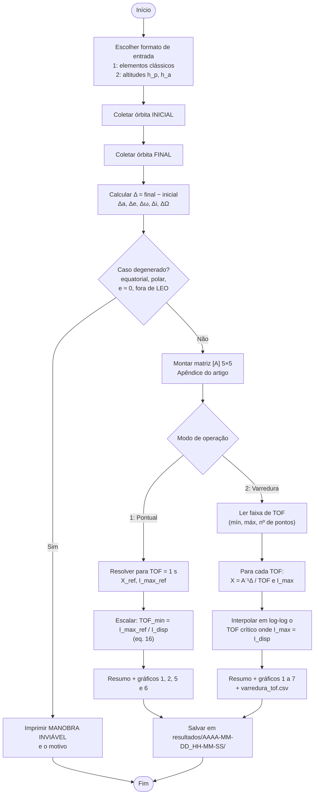
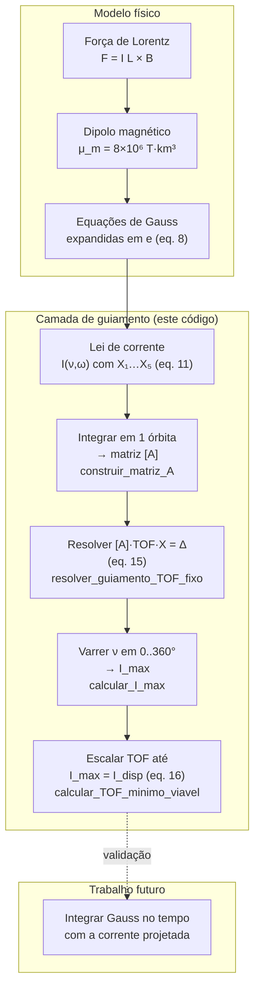
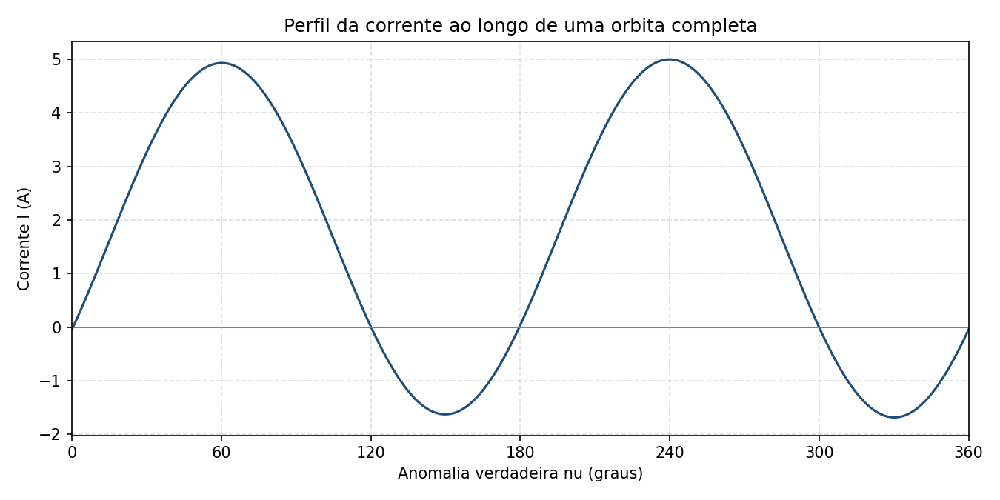
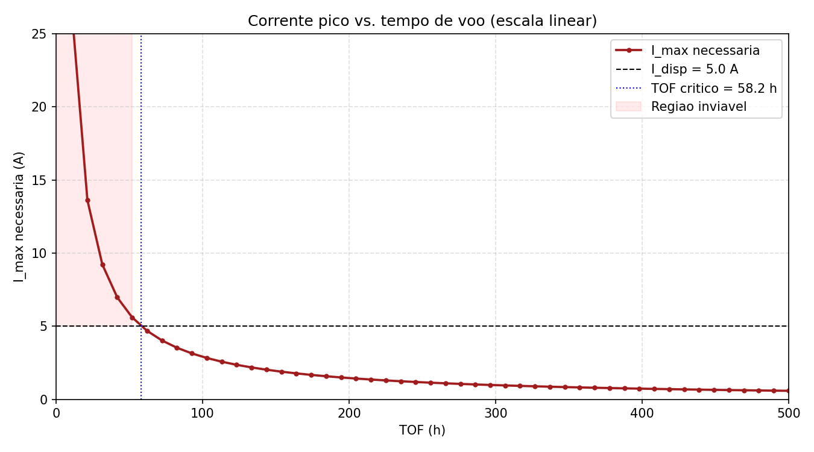
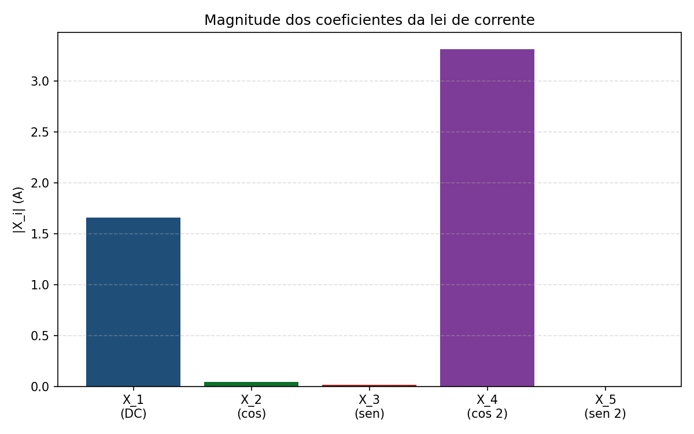
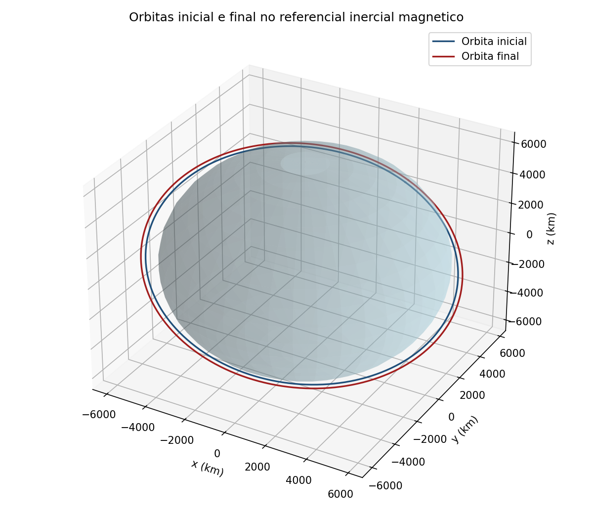
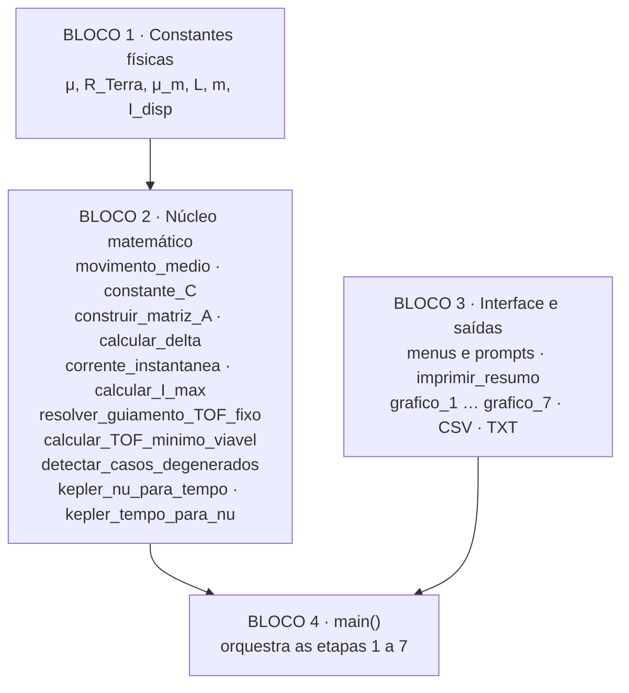

# Análise computacional de manobras orbitais com Tethers eletrodinâmicos

Código-fonte em Python que implementa a **camada de guiamento** do método de
**Tragesser e San (2003)** para manobras orbitais com *tethers*
eletrodinâmicos (EDT). Dada uma órbita inicial e uma órbita final desejada, o
programa calcula **qual lei de corrente** precisa circular no cabo e **quanto
tempo** (TOF, *time of flight*) a manobra leva, respeitando a corrente máxima
disponível a bordo.

> Referência base: TRAGESSER, S. G.; SAN, H. *Orbital Maneuvering with
> Electrodynamic Tethers.* Journal of Guidance, Control, and Dynamics,
> v. 26, n. 5, p. 805–810, 2003.

---

## Sumário

1. [O que é um tether eletrodinâmico](#1-o-que-é-um-tether-eletrodinâmico)
2. [O problema que o código resolve](#2-o-problema-que-o-código-resolve)
3. [Fluxograma do programa](#3-fluxograma-do-programa)
4. [Fluxograma do método matemático](#4-fluxograma-do-método-matemático)
5. [Como executar](#5-como-executar)
6. [Entradas e saídas](#6-entradas-e-saídas)
7. [Exemplo: *orbit raising* do artigo](#7-exemplo-orbit-raising-do-artigo)
8. [Estrutura do código](#8-estrutura-do-código)
9. [Casos degenerados (manobras inviáveis)](#9-casos-degenerados-manobras-inviáveis)
10. [Hipóteses e limitações](#10-hipóteses-e-limitações)
11. [Referências](#11-referências)

---

## 1. O que é um tether eletrodinâmico

Um *tether* eletrodinâmico é um cabo condutor longo (aqui, **15 km**) preso a
um satélite. Ao se mover pelo campo magnético da Terra, o cabo pode conduzir
uma corrente elétrica **I** fechando o circuito pelo plasma da ionosfera. A
interação dessa corrente com o campo magnético gera a **força de Lorentz**:

$$\vec{F} = I\,\vec{L} \times \vec{B}$$

Essa força funciona como um propulsor **sem combustível**: modulando a
corrente ao longo da órbita é possível subir ou descer a órbita, mudar a
excentricidade, a inclinação, o nodo, etc. O desafio é descobrir *qual*
corrente aplicar e *em que momento* da órbita.

## 2. O problema que o código resolve

Este é o chamado **problema inverso de guiamento**:

| Você informa | O código devolve |
|---|---|
| Órbita inicial (a, e, ω, i, Ω) | Coeficientes X₁…X₅ da lei de corrente |
| Órbita final desejada | Tempo de voo mínimo viável (TOF) |
| Corrente máxima disponível (5 A) | Pico de corrente I_max ao longo da órbita |
| | Gráficos, tabela CSV e resumo em texto |

A lei de corrente proposta pelo artigo (eq. 11) é uma combinação de cinco
formas funcionais, cada uma ligada principalmente a um elemento orbital:

$$I(\nu,\omega) = X_1 + X_2\cos\nu + X_3\sin\nu + X_4\cos[2(\nu+\omega)] + X_5\sin[2(\nu+\omega)]$$

| Coeficiente | Forma | Elemento afetado principalmente |
|---|---|---|
| X₁ | constante (DC) | semieixo maior **a** |
| X₂ | cos ν | excentricidade **e** |
| X₃ | sen ν | argumento do perigeu **ω** |
| X₄ | cos 2(ν+ω) | inclinação **i** |
| X₅ | sen 2(ν+ω) | longitude do nodo **Ω** |

Substituindo essa lei nas equações de Gauss e integrando sobre uma órbita, as
variações seculares ficam **lineares** em X. Isso dá um sistema 5×5:

$$[A]\,\mathrm{TOF}\,X = \Delta \quad\Rightarrow\quad X = \frac{1}{\mathrm{TOF}}[A]^{-1}\Delta \quad\text{(eq. 15)}$$

Como X escala com 1/TOF, o pico de corrente também escala com 1/TOF. Basta
resolver para um TOF de referência e reescalar até que I_max = I_disp
(eq. 16). Esse é o **TOF mínimo viável**.

## 3. Fluxograma do programa

Visão do que acontece quando você roda `python simulacao_tether.py`:



## 4. Fluxograma do método matemático

O caminho da física até a lei de corrente, e onde cada passo vive no código:



## 5. Como executar

Requisitos: **Python 3.9+**, `numpy` e `matplotlib`.

```bash
git clone https://github.com/gabrielgambinii/Analise-computacional-manobras-orbitais-Tethers_C-digo-fonte.git
```

```bash
cd Analise-computacional-manobras-orbitais-Tethers_C-digo-fonte
```

```bash
pip install -r requirements.txt
```

```bash
python simulacao_tether.py
```

O programa é interativo. **Aperte Enter em todas as perguntas** para usar os
valores padrão, que reproduzem o exemplo de *orbit raising* do artigo
(subir a órbita em 200 km).

## 6. Entradas e saídas

### Entradas (pelo terminal)

| Pergunta | Unidade | Padrão |
|---|---|---|
| Formato de entrada | 1 ou 2 | 1 |
| Semieixo maior a | km | 6878 → 7078 |
| Excentricidade e | – | 0,02 |
| Argumento do perigeu ω | graus | 30 |
| Inclinação i (referencial **magnético**) | graus | 30 |
| Longitude do nodo Ω (referencial **magnético**) | graus | 50 |
| Modo de operação | 1 pontual, 2 varredura | 1 |
| Faixa de TOF (só varredura) | h | 1 a 500, 50 pontos |

### Constantes do sistema (Bloco 1 do código)

| Constante | Valor | Origem |
|---|---|---|
| μ Terra | 3,986×10⁵ km³/s² | clássica |
| Raio da Terra | 6378 km | clássica |
| Momento de dipolo μ_m | 8×10⁶ T·km³ | eq. 3, p. 805 |
| Comprimento do tether L | 15 km | p. 808 |
| Massa do sistema m | 1000 kg | p. 808 |
| Corrente disponível I_disp | 5 A | p. 808 |

### Saídas (pasta `resultados/<data_hora>/`)

| Arquivo | Conteúdo | Modo |
|---|---|---|
| `resumo.txt` | Órbitas, Δ, TOF, I_max, X₁…X₅ e modo dominante | ambos |
| `grafico_1_I_nu.png` | Corrente ao longo de uma órbita, I × ν | ambos |
| `grafico_2_I_t.png` | Corrente no tempo nas 3 primeiras órbitas | ambos |
| `grafico_3_Imax_vs_TOF.png` | I_max × TOF em escala log-log | varredura |
| `grafico_4_Xi_vs_TOF.png` | Cada coeficiente X_i × TOF | varredura |
| `grafico_5_barras_Xi.png` | Magnitude de cada X_i | ambos |
| `grafico_6_orbitas_3d.png` | Órbitas inicial e final em 3D | ambos |
| `grafico_7_Imax_vs_TOF_linear.png` | I_max × TOF em escala linear, com região inviável | varredura |
| `varredura_tof.csv` | Tabela TOF, X₁…X₅, I_max | varredura |

## 7. Exemplo: *orbit raising* do artigo

Rodando com os valores padrão (Δa = +200 km, demais elementos constantes),
modo varredura de 1 h a 500 h. Os arquivos completos estão em
[`docs/exemplo_orbit_raising/`](docs/exemplo_orbit_raising/).

```text
Solucao (eq. 15 de Tragesser e San, 2003):
  TOF = 58h 10min (58.18 h)
  I_max = 5.0000 A  (I_disponivel = 5.0 A)

Coeficientes da lei de corrente (eq. 11):
  X_1 (DC)              = +1.6554 A
  X_2 (cos nu)          = -0.0414 A
  X_3 (sen nu)          = -0.0150 A
  X_4 (cos[2(nu+w)])    = -3.3109 A
  X_5 (sen[2(nu+w)])    = -0.0000 A
```

**Como ler esse resultado:** para subir a órbita é preciso uma corrente DC
(X₁). Só que, numa órbita inclinada, essa corrente DC também mexe na
inclinação (termo A₄₁ = −2C sen i da matriz). Para que **i** fique
constante, o método liga o modo X₄ para cancelar esse efeito colateral. É
exatamente o **acoplamento cruzado** que o artigo destaca, e é por isso que
X₄ aparece como modo dominante mesmo numa manobra de "só subir a órbita".

| Corrente ao longo de uma órbita | Corrente pico × tempo de voo |
|---|---|
|  |  |

| Coeficientes da lei de corrente | Órbitas inicial e final |
|---|---|
|  |  |

Repare na hipérbole I_max ∝ 1/TOF: quanto mais rápido você quer a manobra,
mais corrente precisa. Abaixo de ~58 h a corrente exigida passa de 5 A e a
manobra fica inviável com esse hardware.

## 8. Estrutura do código

Tudo está em um único arquivo, [`simulacao_tether.py`](simulacao_tether.py),
dividido em quatro blocos:



| Função | O que faz | Equação |
|---|---|---|
| `movimento_medio(a)` | n = √(μ/a³) | Kepler |
| `constante_C(a, n)` | C = L·μ_m / (4·m·n·a⁴) | Apêndice, p. 810 |
| `construir_matriz_A(a, e, i, ω)` | Monta a matriz de acoplamento 5×5 | Apêndice |
| `calcular_delta(ini, fin)` | Vetor Δ = final − inicial | eq. 14 |
| `corrente_instantanea(ν, ω, X)` | Avalia I(ν, ω) | eq. 11 |
| `calcular_I_max(X, ω)` | Pico de \|I\| varrendo ν em 720 pontos | p. 807 |
| `resolver_guiamento_TOF_fixo` | X = A⁻¹Δ / TOF | eq. 15 |
| `calcular_TOF_minimo_viavel` | TOF em que I_max = I_disp | eq. 16 |
| `detectar_casos_degenerados` | Bloqueia manobras impossíveis | seção 9 |
| `kepler_tempo_para_nu` | Newton-Raphson para Kepler, usado no gráfico I × t | clássica |

## 9. Casos degenerados (manobras inviáveis)

Antes de resolver, o código verifica se a matriz [A] perde posto ou fica mal
condicionada. Se cair em algum caso abaixo, ele para e explica o motivo.

| Caso | Condição | Por que não dá |
|---|---|---|
| 1 | i = 0° ou 180° e Δi ou ΔΩ ≠ 0 | Força fora do plano orbital se anula (sen i = 0) |
| 2 | i = 90° e Δa, Δe ou Δω ≠ 0 | Força no plano orbital se anula (cos i = 0) |
| 3 | e = 0 | ω indefinido e A₃₃ = 4C cos i / e diverge |
| 4 | e < 10⁻⁴ | Matriz mal condicionada, resultados imprecisos |
| 5 | a > 2·R_Terra | Fora de LEO, plasma ionosférico insuficiente |

## 10. Hipóteses e limitações

* **Só a camada de guiamento.** O código resolve o problema inverso de forma
  algébrica. A simulação dinâmica (integrar as equações de Gauss no tempo com
  a corrente projetada para validar a manobra) **não está implementada** e
  fica como trabalho futuro.
* **Elementos médios constantes.** A matriz [A] é calculada uma vez com a
  órbita inicial, assumindo que os elementos variam pouco em cada órbita.
* **Campo magnético dipolar alinhado.** i e Ω devem ser informados no
  **referencial magnético**, não no geográfico.
* **Expansão em excentricidade.** O método vale para órbitas de baixa
  excentricidade em LEO.
* **I_max por enumeração.** O pico é obtido varrendo ν em passos de 0,5°,
  como sugerido pelo próprio artigo.

## 11. Referências

* TRAGESSER, S. G.; SAN, H. *Orbital Maneuvering with Electrodynamic
  Tethers.* Journal of Guidance, Control, and Dynamics, v. 26, n. 5,
  p. 805–810, 2003.
* VALLADO, D. A. *Fundamentals of Astrodynamics and Applications.*
  (rotações para o referencial inercial no gráfico 3D).
